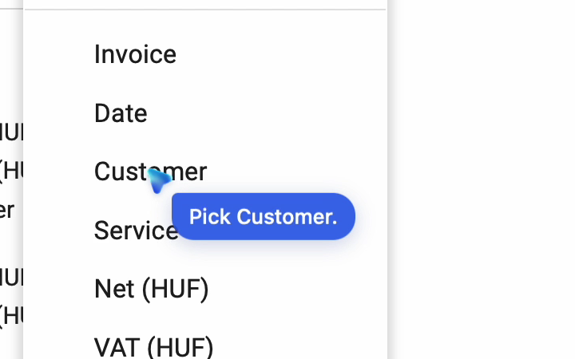
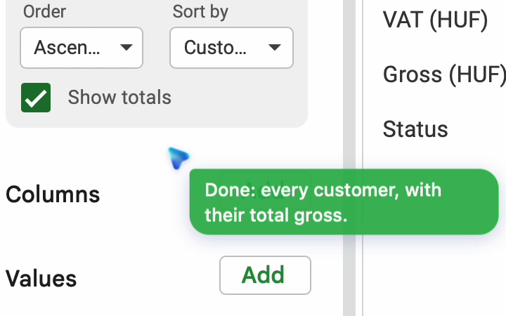
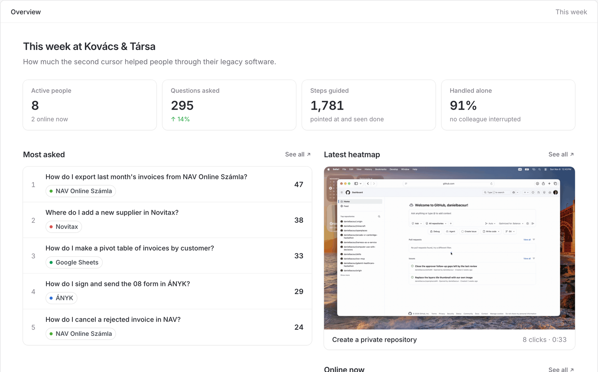
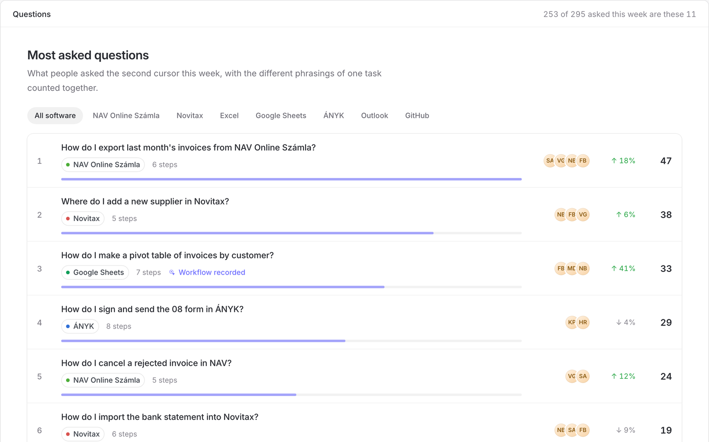
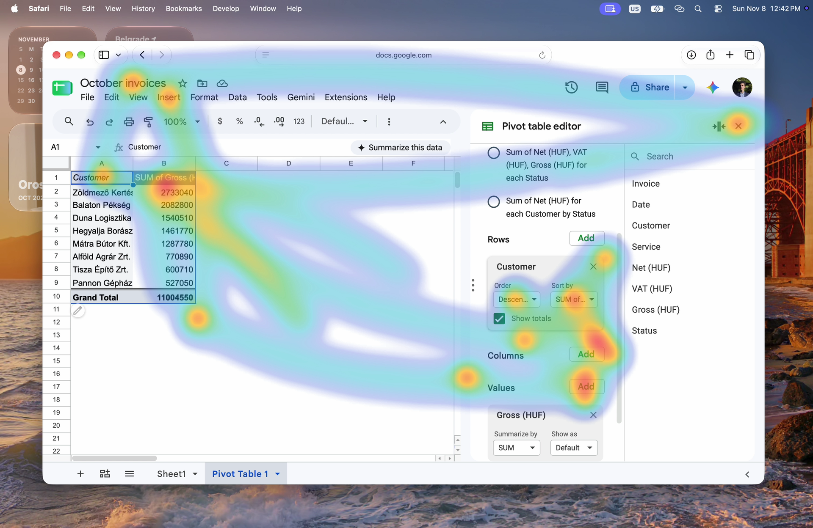

<h1 align="center">mesh.</h1>

<p align="center">
  A second cursor that shows you where to click, step by step.
</p>

<p align="center">
  
  
</p>

<div align="justify">
  <p>
    New employees learn legacy software by watching someone click through it. <b>mesh learns how a firm's best people do their work, then teaches it back to everyone else, right on their screen.</b> Ask a question, and a second cursor points at each click, waits for you to take it, and moves on to the next one.
  </p>
</div>

<br/>

<h2>The problem</h2>

<div align="justify">
  <p>
    <b>Every new hire costs weeks of an experienced colleague's time.</b> The tools accounting firms run on &mdash; tax, invoicing and bookkeeping software &mdash; rarely come with a manual, so juniors learn them by watching someone click, and when that someone leaves, the way they did the job leaves with them.
  </p>

  <p>
    <b>We asked a Hungarian accounting firm with over 70 employees and more than $2M in yearly revenue.</b> Training a junior takes them 4&ndash;5 weeks of full-time work, and new people keep adapting for the first 2&ndash;3 months after that.
  </p>
</div>

<br/>

<h2>How it works</h2>

<div align="justify">
  <p>
    <b>First, we learn.</b> People work as usual while we record how they move and click. Each workflow becomes a heatmap of where the work happens; heatmaps become workflow embeddings that can be compared across people; and from those we write the best way to do each task down as a skill, a <code>SKILL.md</code> file.
  </p>

  <p>
    <b>Then, we guide.</b> Someone asks a question in their own words. The second cursor reads the screen, points at the next control and says what to do there, waits until they have done it, and guides the step after, following the skills learned from their colleagues. When the task is done, it comes back beside the mouse and says so.
  </p>

  <p>
    <b>Every question lands on a dashboard.</b> It shows what people ask most, in which software, who asks, and which workflow is worth recording next &mdash; the most asked question without a recording is the next thing to learn.
  </p>
</div>

<p align="center">
  
</p>

<p align="center">
  
</p>

<p align="center">
  
</p>

<div align="justify">
  <p>
    <b>The same skills can run agents on their own.</b> A <code>SKILL.md</code> is the format agents already use, so the files that guide a new hire today could let an agent do the whole task tomorrow.
  </p>
</div>

<br/>

<h2>What is in this repository</h2>

<div align="justify">
  <p>
    <b><code>apps/desktop</code> is the second cursor,</b> a Tauri app for macOS. Option+Space opens a prompt beside the mouse, and an overlay draws the second cursor and its speech bubble above every window, menus included.
  </p>

  <p>
    <b><code>agents/cursor</code> is the agent behind it,</b> built with eve. It sees a screenshot of the window in use, plans tasks that take more than one step, and answers with its <code>point_at</code> and <code>plan</code> tools.
  </p>

  <p>
    <b><code>apps/dashboard</code> is the team dashboard,</b> a Next.js app with the people, the most asked questions by software, and heatmaps of recorded workflows with their place in the learning pipeline. Its people and questions are sample data for the pitch; its two heatmaps are recordings from a Mac, a pivot table of invoices in Google Sheets and a private repository created on GitHub.
  </p>

  <p>
    <b><code>tools/heatmap</code> is the recording pipeline.</b> It records the screen together with the pointer and renders each recording into a heatmap. Recording and heatmaps work today; workflow embeddings and writing <code>SKILL.md</code> files from them are the next steps of the pipeline, shown on the dashboard as not yet done.
  </p>
</div>

<br/>

<h2>Running it</h2>

```bash
npm install
```

<div align="justify">
  <p>
    <b>You need macOS, Node.js with npm 11, and Rust for the desktop app.</b> The heatmap tools also need the Swift toolchain from the Xcode command line tools, and ffmpeg.
  </p>
</div>

```bash
npm run dev -w agents/cursor
```

<div align="justify">
  <p>
    <b>The agent listens on port 3001.</b> It calls its model through the Vercel AI Gateway, so it needs gateway credentials in its environment.
  </p>
</div>

```bash
npm run dev -w apps/desktop
```

<div align="justify">
  <p>
    <b>The second cursor expects the agent on <code>127.0.0.1:3001</code>,</b> or wherever <code>VITE_AGENT_URL</code> points. Give it Screen Recording permission when macOS asks, then press Option+Space in any app and ask.
  </p>
</div>

```bash
npm run dev -w apps/dashboard
```

<div align="justify">
  <p>
    <b>The dashboard runs on port 3002</b> and reads its recordings from <code>apps/dashboard/public/heatmaps</code>. It is also deployed at garaza.danielbacsur.dev.
  </p>
</div>

<br/>

<h2>Recording heatmaps</h2>

```bash
tools/heatmap/record.sh <name>
tools/heatmap/render.sh <name> --title "…" --app "…" --by "…"
```

<div align="justify">
  <p>
    <b><code>record.sh</code> records the screen and the pointer until Ctrl+C,</b> and <code>render.sh</code> turns the recording into a GIF, a still of the whole workflow's heatmap, and a small manifest in the dashboard's <code>public/heatmaps</code>, where it shows up without any code change.
  </p>

  <p>
    <b>Heat follows movement, not time spent still.</b> Recent paths cool off, a thin tail follows the pointer, and every click ripples. <code>--half-life</code> sets how fast heat fades, <code>--travel</code> how much movement makes heat, and <code>--scale</code>, <code>--tail</code>, <code>--lag</code>, <code>--speed</code>, <code>--width</code> and <code>--fps</code> tune the rest.
  </p>
</div>

<br/>

<h2>Team</h2>

<div align="justify">
  <p>
    Daniel Bacsur, Benedek Bencz, Dávid Melján and Csongor Vincze Farkas.
  </p>
</div>
